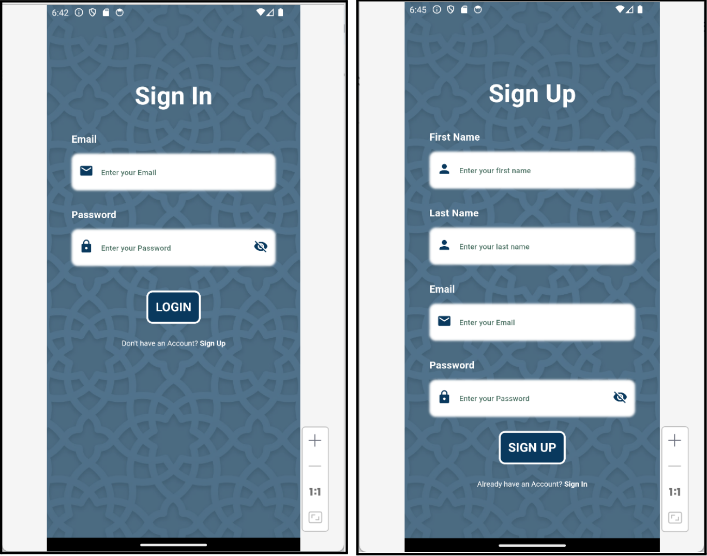
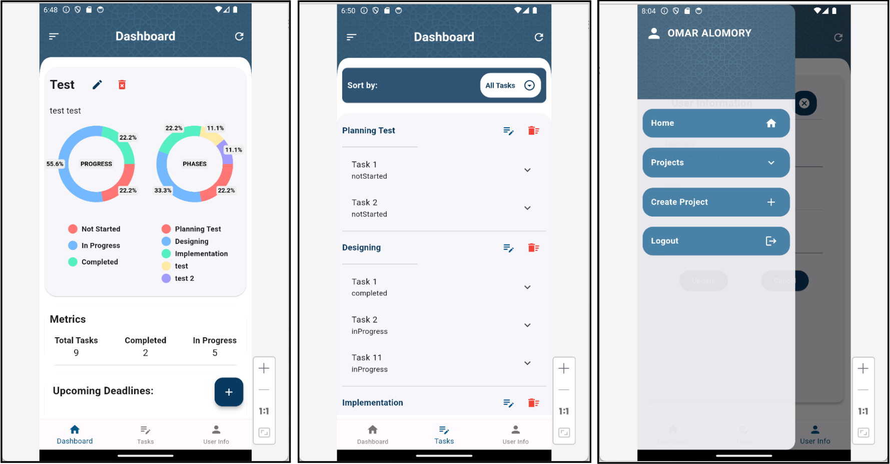
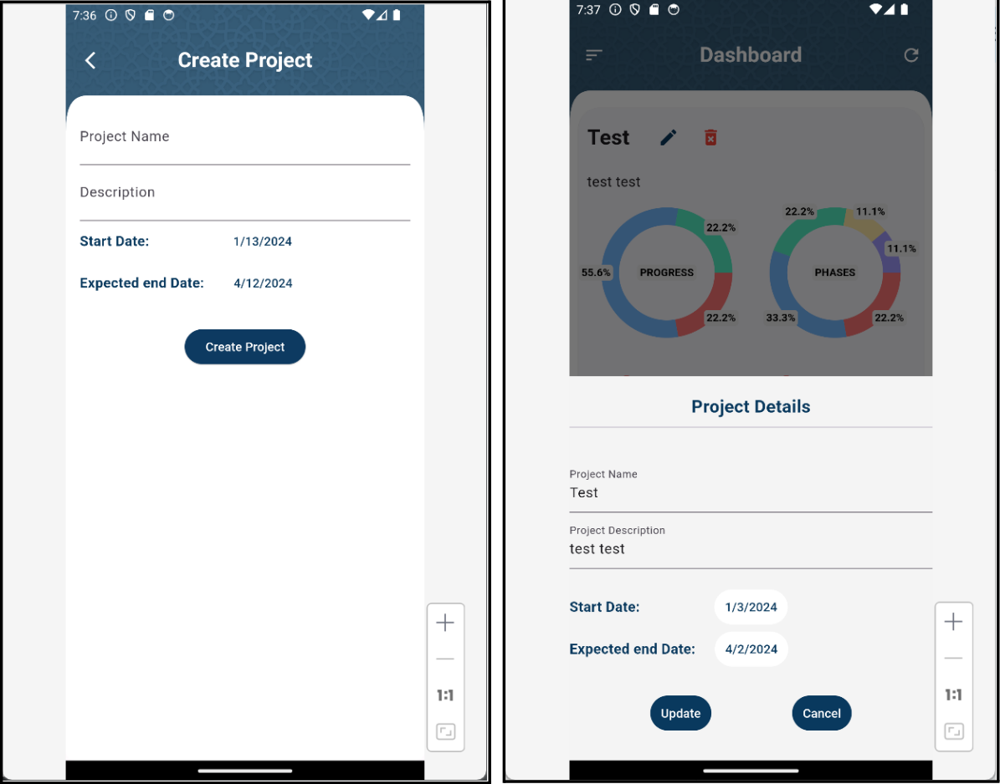
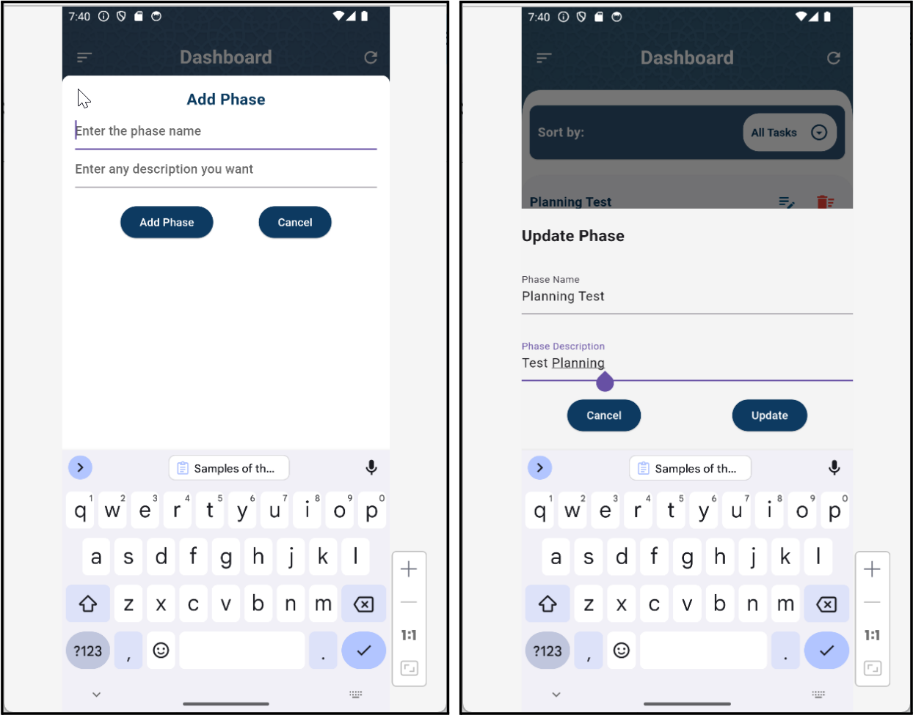
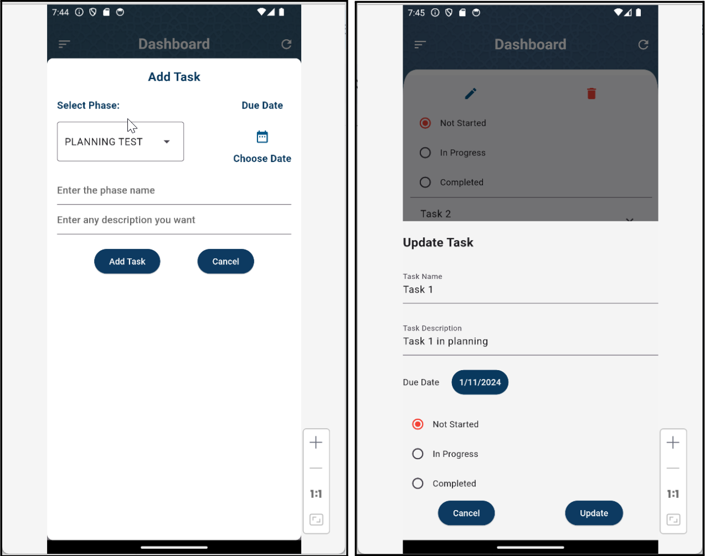
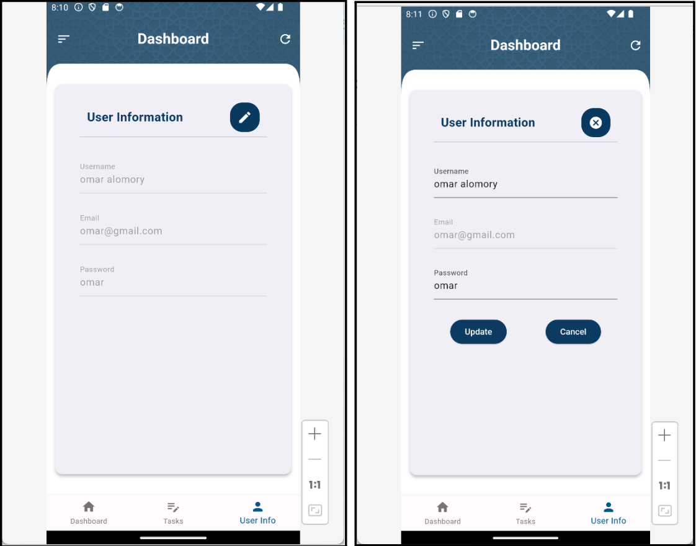

# Project Monitoring & Tracking App

A Flutter application for organising projects, collaborating with team members, and monitoring project progress. Users can add teammates by email, manage project work, and track completion through the app.

## Screenshots











<!--  -->
<!-- <p align="center">
  
  
  
</p> -->

## Features

- Create and manage projects.
- Add team members using their email addresses.
- Organise and complete project work.
- Monitor project progress and completion.
- Store application data with Firebase.

## Technology

- Flutter and Dart
- Firebase

## Run locally

**Requirements:** Flutter SDK, an Android or iOS development environment, and access to the Firebase project configuration used by the app.

From the project root:

```bash
flutter pub get
flutter run
```

To build a release APK:

```bash
flutter build apk --release
```

Configure Firebase for the target platform before running the application. Review database security rules before using real user data, and keep private credentials and signing keys out of version control.

## Project structure

The Flutter application is organised around data access, models, screens, themes, and reusable widgets. Images and screenshots are stored separately under `assets/`.

```text
lib/
├── data/
├── models/
├── screens/
├── themes/
└── widgets/

assets/
├── images/
└── screenshots/
```

## License

Distributed under the MIT License. See [LICENSE](LICENSE).
